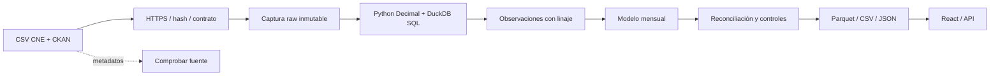

# Arquitectura implementada

## Contrato

Identidad de observación: `(snapshot_sha256, source_row)`. `source_row` enumera registros desde 1; su línea física en CSV es +1 por la cabecera. Las anomalías del inspector informan la línea física. El nombre de central no es una clave única.

Columnas raw: `anio,mes,tecnologia,subsistema,clasificacion,codigo_central,generacion_mwh,fecha_act`. Campos obligatorios, mes válido, año desde 2014 hasta año de ejecución, fecha ISO, SIC/SING y ERNC/Convencional. Una categoría nueva requiere revisar contrato. No se normaliza silenciosamente.

SQL utiliza DECIMAL(30,10); Python Decimal suma independientemente el CSV. JSON double sirve para consulta y no es árbitro de reconciliación. Parquet conserva decimales. Modelo mensual: `period,technology,subsystem,classification`; conserva `source_rows` y `plant_codes`. No sumar los conteos distintos de central entre grupos para calcular centrales únicas del sistema.

## Indicadores

| Indicador | Fórmula y límite |
|---|---|
| Generación | SUM(mwh) filtrada / 1000 |
| Participación ERNC | 100 × energía ERNC / energía seleccionada |
| Interanual | 100 × (actual / mismos meses año anterior − 1), todos los meses presentes en ambas selecciones y base positiva |
| Cobertura | Meses distintos con observaciones de la selección; no completitud por central |
| Mix | SUM(mwh) por tecnología; barras relativas al máximo mostrado |

Filtrar ERNC produce 100% dentro de esa selección, no del sistema. La comparación no supone parque constante. Los meses sin observaciones quedan como huecos, no cero. Un agregado que redondea a 0,0 GWh conserva su valor exacto en tabla/CSV.

## Operación y fallos

Offline por defecto; `--refresh` consulta HTTPS datos.gob.cl, timeout 45 s, tres intentos, límite 25 MiB y comprobación del destino final. Raw por hash; última metadata apunta a la captura elegida. Errores de hash/contrato/sumas ocurren antes de reemplazar el JSON publicado.

Exportación con orden explícito para resultados repetibles, temporales `.tmp` y reemplazo atómico por archivo. No existe una transacción para todos los formatos: construir/desplegar solo después de finalizar. Dos pipelines concurrentes no están soportados. Cada versión Git identifica la transformación, además del hash que identifica el origen.

App: `lib/generated/dataset.json`; descarga equivalente: `public/data/dataset.json`. API/navegador comparten `lib/gridops.ts`. Sin SQL arbitrario. `source-status`: host fijo, timeout 10 s, comparación solo de metadata y ninguna modificación del dataset.

Los botones de exportación usan la API CSV del mismo origen con Content-Disposition attachment. Esto conserva los filtros y funciona también en navegadores integrados que no descargan blobs locales. Exportar requiere conexión al sitio publicado.

## Decisiones

- DuckDB: 6,7 MB, batch y sin transacciones de usuarios; SQL y Parquet transferibles. No se justifica un clúster.
- Sin Spark/Kafka/Kubernetes: no hay volumen/streaming que compense operación adicional.
- Sin dbt/Dagster instalado: dos modelos y una fuente, con contratos ejecutados directamente. Reevaluar cuando crezcan fuentes, dependencias, backfills y jobs operados.
- React/TypeScript + shadcn + Recharts; Vinext/Workers responde al destino Sites. Vinext es beta: probar ese runtime, no asumir equivalencia perfecta con Next.js.
- Las tres páginas navegan con enlaces HTML nativos. El Link RSC del build publicado falló al precargar y navegar; las recargas completas evitan esa dependencia. Los filtros y gráficos siguen siendo interactivos dentro del explorador.
- Sin GPU/LLM en KPI: esta escala no los requiere. La RTX 5090 queda disponible para futuros trabajos que necesiten cómputo matricial o inferencia.
- WebMCP como mejora progresiva: lectura de resumen y filtros validados. UI convencional independiente de esa API.

## Seguridad

Sin secretos en cliente, subidas de archivos o escritura desde el explorador. CSV protege textos con prefijos de fórmulas y mantiene cantidades numéricas negativas. React escapa etiquetas; no se inyecta HTML de la fuente. Acceso gestionado por hosting; el explorador público no requiere identidad ni permite escribir datos. Dependencias fijadas por lockfile; actualizar con pruebas y build. No se afirma auditoría de seguridad externa.
