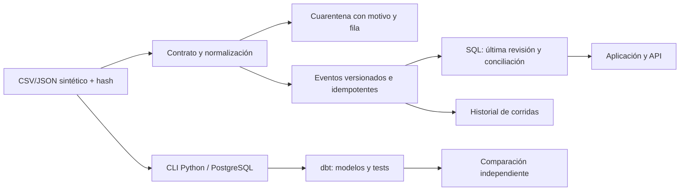

# OpsForge · plan de ejecución aceptado

Estado inicial: aprobado por el usuario para ejecución autónoma. Alcance: entregar el siguiente proyecto completo del portfolio, después de GridOps. Este documento distingue compromisos de ejecución de evidencia obtenida; los resultados se registrarán al cierre.

## 1. Brief y definición de terminado

OpsForge concilia pedidos, facturas y entregas de una distribuidora ficticia. El usuario operativo identifica una diferencia, consulta la fuente, procesa una corrección o llegada tardía y comprueba el resultado. El recruiter puede ejecutar el mismo recorrido sin instalar herramientas ni entregar datos personales.

Terminado exige: aplicación pública funcional integrada en el portfolio; motor real de ingestión con persistencia; historial y cuarentena; consulta SQL; descargas; paquete Python/SQL/dbt reproducible; pruebas independientes de idempotencia y recuperación; comprobaciones del hosting; documentación de uso, arquitectura, contratos, límites y resultados. No basta una interfaz sobre contadores programados ni una animación que pretenda ejecutar trabajos.

## 2. Alcance contractual

- Un flujo pedido → factura → entrega, con múltiples documentos por pedido cuando corresponda.
- Fuentes sintéticas propias, CSV y JSON, con semilla, manifiesto SHA-256, versión y resultado esperado. Sin clientes, empresas o ahorros ficticiamente atribuidos.
- Ingestión inicial, reingestión idéntica, eventos tardíos/correcciones versionadas, datos inválidos, esquema incompatible e interrupción controlada con recuperación.
- Conservación de original, fila de origen, identidad lógica del evento, versión y hash. Un evento de una misma versión con payload distinto se envía a cuarentena.
- Importes en unidades monetarias menores enteras. CLP y USD separados; no suma entre monedas ni conversión de divisas inventada. Cantidades enteras y unidades explícitas.
- No se incorporan datos privados ni credenciales ERP. Los conectores descargables consumen archivos o un endpoint de prueba controlado.

## 3. Arquitectura y decisiones de plataforma

El sitio existente corre en Cloudflare Workers: la aplicación pública utiliza D1/SQLite para operaciones durables. El pipeline de referencia usa Python y PostgreSQL con modelos dbt. Se reutiliza SQL de conciliación portable y se comparan resultados entre motores. El sitio no afirmará que aloja PostgreSQL ni que ejecuta Python dentro del navegador.

La publicación no dependerá de un proceso en el PC. Persistencia en servidor para datos de trabajo; almacenamiento del navegador solo para preferencias. Espacios de prueba aislados con cookie aleatoria HttpOnly, expiración y límites. No se modifica GridOps ni se comparte el estado de un visitante con otro.

## 4. Modelo de datos y reglas

1. Espacio: identidad aleatoria, creación, expiración y revisión para control de concurrencia.
2. Corrida: escenario/lote, inicio/fin, estado, contadores, error y revisión publicada. Los fallos quedan registrados sin publicar una tabla parcial.
3. Evento: espacio + tipo de documento + ID + versión como clave única; order_id, importe, moneda, cantidad, unidad, fecha del evento, archivo/fila/hash.
4. Rechazo: original y motivo; nunca se transforma silenciosamente un dato inválido en cero.
5. Modelos SQL: última versión por documento → importes/cantidades por pedido → diferencias y estado. Se agregan documentos antes de unirlos para evitar multiplicación por joins.

Controles: campos exactos, ID/fecha válidos, moneda/unidad admitidas, enteros dentro de límites, versión positiva, conflicto de misma versión, referencia de pedido, unicidad y conciliación. Una referencia aún ausente puede quedar pendiente y resolverse cuando llegue el pedido; una moneda distinta debe seguir visible como discrepancia.

## 5. Experiencia y diseño

Dirección visual: mesa de conciliación operativa, tipografía legible, fondo claro, navegación en tinta y acento naranja cobre; contraste con el azul de GridOps conservando la marca Sebastián Cortés. Cero imágenes decorativas: el dato y su linaje son la imagen principal.

Primera pantalla: resumen del espacio, acción de carga y lista de pedidos con diferencias. Navegación entre conciliación, corridas, cuarentena y fuentes. Filtro por estado/moneda y búsqueda; detalle del pedido con pedido/factura/entrega, diferencia y eventos originales. Historial expandible con contadores reales. Estados vacíos, de carga, fallo, expiración y recuperación explícitos. Descargas HTTP compatibles con el navegador integrado.

No habrá porcentajes de progreso ni tiempos simulados. Las operaciones reportarán la respuesta real del servidor. La explicación de casos y arquitectura vive en una página de proyecto, separada de la superficie operativa.

## 6. Fases y criterios de aceptación

### Fase A · contratos y datos
Generar fixtures con semilla; conservar CSV/JSON y hashes; especificar oráculos antes del motor. Incluir casos de conciliado, sin factura, entrega parcial, importe distinto, unidad/moneda distinta, duplicado, versión corregida, huérfano y dato inválido. Cierre: fixture regenerado idéntico y expectativas independientes.

### Fase B · ingestión y SQL
Implementar parser/validador, identidad y versiones; consultas sin interpolar entradas. Registrar corrida y hacer publicación atómica con revisión optimista. Repetir un lote no duplica hechos ni importes. Un fallo inyectado revierte la transacción. Cierre: pruebas de invariantes y comparación SQL independiente.

### Fase C · pipeline Python y PostgreSQL/dbt
Preparar runtime aislado, sin servicio permanente ni cambios globales; descargar componentes de fuentes oficiales si faltan. CLI de carga CSV/REST de prueba, raw inmutable, SQL y dbt con tests explícitos. Docker Compose y CI reproducibles. Ejecutar lo disponible y documentar exactamente cada comprobación; no contar Docker/CI como ejecutados por existir YAML.

### Fase D · producto web
Crear rutas /opsforge y /opsforge/caso; backend persistente y API de lectura/operación limitada a escenarios de prueba. Implementar detalle, búsqueda, filtros, corridas, cuarentena, fuentes y exportación. Cierre: todo control relevante ejecuta una función útil, con datos reales del motor y sin placeholders.

### Fase E · robustez
Probar aislamiento de dos visitantes, ausencia de cookie, origen inválido, límite de payload, escenario inválido, expiración, doble ejecución y carrera de revisión. Pruebas de filas malformadas, mezcla monetaria, multiplicación de joins, rollback y recuperación. Cierre: fallos no corrompen la última versión válida ni filtran otro espacio.

### Fase F · portfolio y publicación
OpsForge como primer proyecto y GridOps como segundo; tesis y ReleaseGuard no se presentan como implementados. Añadir caso técnico, README, diccionario, guía de reproducción, ejemplos de API, recorrido de tres minutos y archivos descargables. Construir, guardar fuente y publicar el mismo sitio con su audiencia pública existente.

### Fase G · cierre verificable
Pruebas HTTP contra el sitio publicado: crear espacio, cargar, consultar, repetir, fallar, recuperar, recargar y exportar. Revisión de enlaces y experiencia dentro de la autorización vigente de cierre del portfolio. Vincular resultados con commit y hashes del paquete. Detener procesos locales propios y entregar URLs y acta.

## 7. Criterios de aceptación precisos

- La segunda carga idéntica agrega cero eventos; importes y número de pedidos permanecen iguales.
- Una revisión superior reemplaza la versión activa del documento y preserva la anterior en linaje.
- Una revisión idéntica con contenido distinto nunca sobrescribe el original.
- Los eventos tardíos corrigen solo los pedidos correspondientes, conservando historia.
- Fallo a mitad de la operación: revisión y hechos publicados se mantienen; la recuperación posterior aplica una sola vez.
- Importe distinto y moneda/unidad incompatible no se etiquetan como conciliados.
- Datos sin padre no desaparecen de la evidencia; la interfaz los muestra como pendientes.
- Cada indicador se puede reconstruir desde API/SQL y archivo/fila original.
- Estado y corridas sobreviven a recargar el navegador; espacios ajenos no son accesibles.
- La aplicación publicada conserva GridOps operativo y permite descargar fuente y resultados.

## 8. Entregables

Aplicación; caso técnico; integración en portada; código fuente descargable; fixtures y manifest; pipeline Python; PostgreSQL/dbt; SQL portable; esquema D1 y migraciones; tests y resultados; Docker/CI; documentación de operaciones y recuperación; recorrido de tres minutos; acta de cierre con límites materiales.

## 9. Fuentes técnicas verificadas

- [PostgreSQL para Windows](https://www.postgresql.org/download/windows/): admite binarios ZIP sin instalador.
- [Binarios oficiales de EDB](https://www.enterprisedb.com/download-postgresql-binaries).
- [D1 batch](https://developers.cloudflare.com/d1/worker-api/d1-database/): las sentencias de batch se ejecutan secuencialmente y el fallo revierte la secuencia.
- [dbt unique_key](https://docs.getdbt.com/reference/resource-configs/unique_key): la configuración no verifica por sí sola la unicidad; se agregan tests explícitos.
- [dbt-postgres](https://pypi.org/project/dbt-postgres/): adaptador oficial, dependencias fijadas para reproducción.

Las fuentes informan decisiones técnicas; no acreditan que una comprobación local o despliegue haya ocurrido. Esa evidencia se añadirá después de ejecutar.
